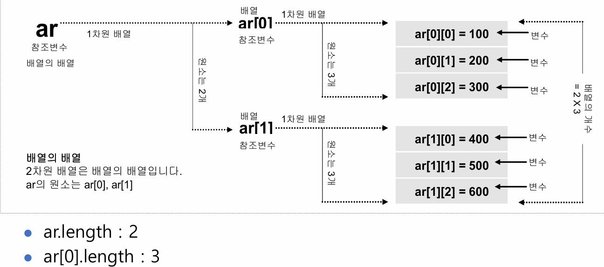

## 4주차 강의자료 정리

### 다차원 배열
- 2차원 배열
  - 2차원 배열의 선언
  
  ```
  int[][] intArray
  int[] intArray[]
  int intArray[][]
    ```
  - 2차원 배열의 초기화
    - 데이터 타입 배열의이름 = new 배열[첨자][첨자]
  ```
  int[][] ar = new int[3][3]
    ```
  
- 가변 배열
  - 2차원 이상의 다차원 배열을 생성할 때, 전체 배열 차수 중 마지막 차수의 길이를 지정하지 않고 생성한 배열
  ```
  int[][] score = new int[3][]
  score[0] = new int[4]
  score[1] = new int[2]
  score[2] = new int[3]
    ```
  
- 파일에서 데이터 읽기
  ```
  File file = new File(source path)
  Scanner scan = new Scanner(file)
    ```
  - 스캐너로 파일에서 데이터를 읽으면 된다.

- 실습 관련 알고리즘
  - 배열에서 자기 랭크 구하기
    - 처음에 1로 순위를 주고 배열을 한번 훓으면서 자기보다 큰게 있으면 순위를 1더하기
    - 시간복잡도 O(n^2) : why? 배열의 원소 하나의 순위를 정하려면 배열을 한번 훓어야하기 때문 : 한번이 n, 근데 n개가 n번을 훓여야하니까
    - 다른 방법은 없을까? => sort하고 sort한 index를 주기 O(nlogn)이지만 공간복잡도가 n이 더 필요하다... trade off가 있다.
    - 참고자료 : [week4_lab](../week04/sanguk/example/example01.java#L92)
  

### 객체지향 프로그래밍
- 객체지향 프로그래밍의 특징
  - 추상화(Abstraction) : 객체가 제공하는 중요한 기능은 드러내고, 내부의 복잡한 구현은 숨기는 것.
    - 예시
      - 결제 방식마다 내부 처리 과정이 복잡함 -> Payment.pay()로 기능정의 -> 구체적인 구현을 몰라도 사용가능
  - 캡슐화/은닉화(Encapsulation) : 객체의 데이터와 데이터를 다루는 매소드를 하나로 묶고, 외부에서 내부 상태를 함부로 변경하지 못하도록 보호하는 것
    - 예시
      - 계좌 잔액을 아무나 수정할 수 있음 -> private과 매서드 접근 통제 -> 객체의 상태보호
  - 상속(Inheritance)
    - 기존 클래스이 필드와 메서드를 물려받아 새로운 클래스를 만드는 것
      - 예시
        - 학생과 교수는 이름, 나이등 공통 특성을 가짐 -> Person을 상속 -> 공통타입과 기능 재사용
  - 다형성(Polymorphism)
    - 동일한 타입으로 메서드를 호출하더라도 실제 객체에 따라 서로 다르게 동작하는 것
      - 예시
        - 동물 종류마다 다른 메서드를 호출해야함 -> Animal 타입으로 sound()호출 -> 실제 객체에 따라 다른 동작 수행
  - SOLID => 따로 알아보자...
  
  - 객체 = 데이터(필드) + 기능(메서드)

### 클래스
- 클래스 : 객체의 설계도
- 객체 : 클래스로 찍어낸 실체
- 클래스 선언 
  - 첫글자는 대문자로 시작해야한다.
  - 소스파일 이름과 동일한 클래스만 public로 선언 가능
- 객체 생성과 참조 변수
  - new 연산자 : 힙 메모리에 객체 생성 후 객체 생성 번지 리턴
  - 참조 변수 : new 연산자에 의해 리턴된 객체의 번지 저장
- 클래스의 구성 멤버
  - 필드 or 멤버변수
  - 생성자(Constructor)
  - 메서드(Method) or 멤버메서드 or 멤버함수
- 매개변수 전달 방식
  - Call by value
    - 기본 타입의 값이 전달되는 경우
    - 실인자 값은 변경되지 않고 복사가 되서 전달이 된다
  - Call by reference
    - 객체가 전달되는 경우
    - 실인자 객체를 공유하기 때문에 내부에서 객체를 바꾸면 외부에서도 바뀐다.
- 매소드 오버로딩
  - 한 클래스내에서 두개 이상의 이름이 같은 메서드 작성하는 것
  - 매서드 이름이 같아야하고 매개변수의 타입, 갯수, 순서가 달라야한다.
  - 여기서 오버로딩과 오버라이딩의 차이점
    - 오버로딩 : 같은 이름의 메서드를 매개변수를 다르게하여 여러개 정의하는 것
    - 오버라이딩 : 부모에게 상소받은 메서드를 자식클래스에서 재정의하여 사용하는 것

참고자료 : [4주차 강의자료](../pdf_summary/4주차_강의자료.pdf)